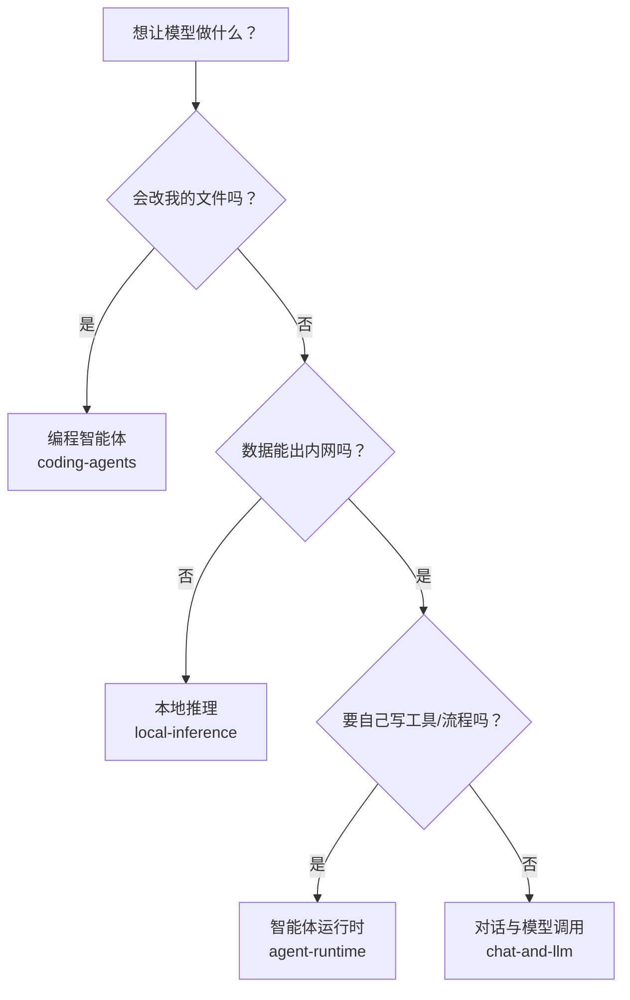

# 🧠 AI / LLM 类 CLI

> 与模型交互的命令行工具。按「你要它做什么」分四类，**不是**按厂商分。

## 四个子分类

| 子分类 | 一句话 | 代表工具 |
| --- | --- | --- |
| [编程智能体](./coding-agents.md) | 读你的代码库并**直接改文件** | Claude Code, Aider, Gemini CLI |
| [对话与模型调用](./chat-and-llm.md) | 把模型当成命令，读 stdin 写 stdout | llm, mods, aichat |
| [本地推理](./local-inference.md) | 权重在你自己的机器上 | Ollama, llama.cpp, vLLM |
| [智能体运行时](./agent-runtime.md) | 工具协议、宿主与流程编排 | MCP Inspector, FastMCP, Temporal CLI |

## 怎么选

## 通用注意事项

- **成本与隐私是一体两面**。云端方案按 token 计费且数据出网；本地方案免费但要
  付出硬件与调参成本。先想清楚这两条底线，再挑工具。
- **模型会变，CLI 也会变**。把「用哪个模型」做成可切换的配置，不要写死在脚本里。
- **不要相信「自动执行」**。凡是能生成并直接执行命令的开关，都应该先读过再开。
- **密钥管理**：放环境变量或系统钥匙串。见
  [安全与加密](../general/security.md)。

## 相关 / See also

- [文本与数据处理](../general/text-and-data.md) —— 消费模型输出的 JSON/YAML
- [Shell 与提示符](../general/shell-and-prompt.md) —— 缩写与别名会让这些工具更好用
